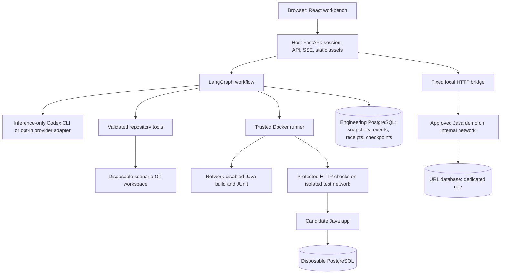

# Architecture

Current-project enhancement runs also use a trusted host GitHub delivery bridge.
It creates an isolated full-repository checkout, exports only validated Java
changes and engineering evidence, and opens a private draft PR. Generated agents
never receive GitHub access. PR creation and local promotion have separate approvals;
see [the enhancement control flow](ENHANCEMENT_DELIVERY.md).

The URL service is the software being engineered. The workbench is its control
plane. User link creation calls Java directly through a fixed local proxy and does
not invoke engineering agents.

The Python process remains on the host to reuse the operator's Codex login without
copying account tokens into Docker. Model processes have shell, browser, plugins,
hooks, images, memory and unrelated tools disabled. They return typed proposals;
they do not operate the computer. The platform applies allowlisted files and runs
fixed commands. Generated Java cannot access the Docker socket or host model keys.

The published source includes the accepted Java service. Each future greenfield
run starts from the independent empty starter. Brownfield starts from the accepted
greenfield baseline. Ambiguous enhancements inspect the currently accepted service.
Only a passing, reviewed, approved candidate is adopted into `backend` and promoted.
The submitted backend's fingerprint must match the run's starting fingerprint,
preventing adoption from overwriting unrelated edits.

The trusted bridge has a fixed destination and forwards business requests only.
Generated demo code stays on an internal Docker network; it has no external egress.
The database role for URL data has no permission to access engineering data. A new
business PostgreSQL container has its own internal network; generated code has no
route to the engineering PostgreSQL container. New promotions retain separate
business database revisions for fresh greenfield and copied enhancement baselines.
See [database promotion](DATABASE_PROMOTION.md). A new
test database and application are created per validation; they are cleaned up and
their results/jar retained in immutable attempt directories.

PostgreSQL checkpointers use threaded synchronous database I/O. On Windows, the
async psycopg loop requirement conflicts with asynchronous subprocess support;
the adapter preserves both without switching off sandbox controls.

Single-process scheduling, local cookies and append-only application APIs are
prototype boundaries. The event hash chain detects changes relative to its stored
head; the same machine's administrator can rewrite both. No independent audit trust
or enterprise identity assurance is claimed.
