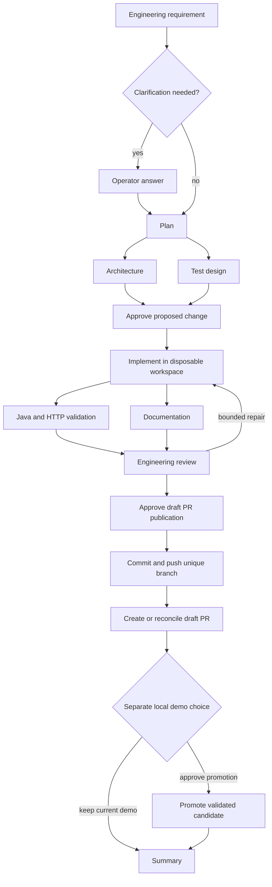

# Current-project enhancements and GitHub delivery

Enhancement is a fourth mode, separate from the three assignment demonstrations.
It copies the current Java source rather than the greenfield starter/baseline and
uses the inherited expiry policy (seven days in the submitted demo). Clarification
is conditional on the actual requirement, with no forced rate-limiter scope.
Existing creation/redirect/analytics/expiry/rate behavior remains protected by
independent HTTP checks; populated V1 upgrade checks also execute in isolation.

The trusted host bridge uses fixed Git/GitHub CLI operations. GitHub access is
checked before model stages: `origin` must be a credential-free github.com URL,
the repository must be private and the operator must have push permission. The
default branch and its exact SHA are captured after fetch. Current Java source
must match that baseline; unrelated/unfinished local backend changes are rejected.
The isolated delivery checkout contains the full trusted repository. Only allowed
Java source, tests, additive migrations, backend documentation and the fixed
`verification/enhancements/<run-id>-r<revision>.json` artifact enter the commit.
The main working tree and default branch are untouched by PR publication.
Windows CRLF and Git LF text endings compare equivalently at baseline/delivery
boundaries and the PR uses LF. Validation still retains the exact input fingerprint
and JAR hash; other content changes are never normalized away.

Publication requires current source revision, passing test result, matching source
fingerprint/JAR hash, passing review and a revision/source-bound approval. Git hooks
and signing are disabled in the owned delivery checkout; no model selects commands,
repository, credentials or arbitrary branch names. Existing migrations and protected
entry/configuration files remain immutable. Credential-like content blocks delivery.
GitHub credential access is confined to this trusted module and never passed into
model prompts, container builds/tests, run state or PR evidence. Raw command errors
are suppressed. The PR and artifact are intentionally published within the private
repository, and contain the requirement and selected engineering/test evidence.

The run-specific journal records source fingerprint, repository/base, deterministic
branch, Git commit/tree and evidence path before any push. On retry, it checks the
same source and clean prepared tree, searches open/merged/closed PRs first, and
compares any remote branch SHA. A successful push or PR creation followed by a lost
response is reconciled without another PR. A changed branch, closed PR, modified
prepared tree or stale source blocks delivery; force-push is never used. Requirement
revision invalidates downstream outputs/approvals and gets a new `r<N>` branch;
an earlier PR remains in GitHub as historical evidence for the earlier requirement.

The PR is visible at the optional local promotion checkpoint. Choosing to finish
without promotion is successful completion, not rejection of the PR. Choosing to
promote copies the current business database and uses the existing rollback journal;
the PR itself is not merged. One active/waiting run and bounded retry/model/time
limits still apply. Local snapshots/journals are not a distributed transaction or
an independently trusted audit archive. GitHub branch protection may deny pushes;
the operator must resolve its policy. No automatic protection bypass is provided.

Subsequent enhancements start from the updated GitHub default branch after the
earlier backend PR is merged and the local checkout is updated. If local promotion
left backend changes in the working tree, preserve them while updating; the app
does not discard or automatically merge those files.
