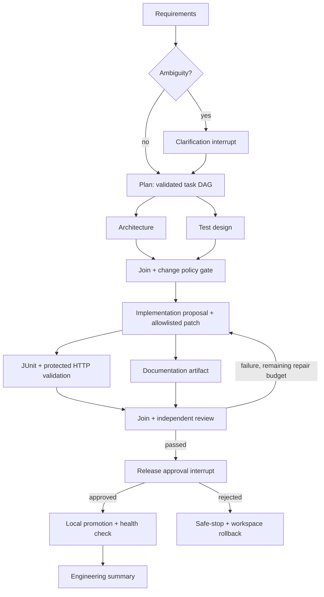

# Stateful orchestration

Each graph node has an entry check for the current revision, run state and active
execution budget. Exit gates verify task DAG validity, permitted changes, measured
tests, source fingerprints and approval provenance. Architecture/test-design and
validation/documentation synchronize before downstream stages.

Requirements, assumptions, tasks, source revisions, outputs, validation attempts,
approvals and configuration changes enter persistent snapshots and ordered events.
LangGraph thread IDs include the run ID and requirement revision. Old revisions
remain inspectable rather than being overwritten.

## Pauses and changes

Clarification and approval use LangGraph interrupts. Approval is bound to revision,
source SHA, approval ID and artifact hash. Rejecting it cannot execute promotion.
Schema/security enhancements pause before implementation, and every live promotion
pauses after passing checks. Greenfield sandbox generation is allowed by policy;
its real schema application still requires the final release decision.

A requirement may change only at a checkpoint. The old artifacts and pending
approval enter lineage, downstream work is invalidated, a new graph revision starts,
and the stale approval is rejected. The current candidate source remains available
for architectural reasoning. Model-call and active-time budgets do not reset.

Configuration changes also require a checkpoint and explicit journal entry. API
keys are transient runtime context, not graph state. After restart an API-backed run
needs fresh credentials before continuing. Codex uses the operator's own login.

## Recovery and bounds

- One active/waiting run; at most two concurrent graph branches.
- At most 24 model calls and 30 minutes of active execution by default.
- Three transient transport attempts; a single schema-correction fallback uses the
  same provider. Never fall back to paid inference from Codex.
- Two source repair cycles per requirement revision. A revision change still shares
  the overall model-call and active-time limits; previous repairs remain in events.
- Fixed command timeouts and output limits; disposable build/test environments.
- Model calls default to 900 seconds, configurable from 30 to 1800 seconds. The
  remaining active-run budget can expire first. Every 15 seconds a persisted
  activity event refreshes elapsed time; it does not imply model token progress.
- Operation receipts prevent replayed stages from blindly applying another patch.
- Restarted workers become interrupted. Resume reconciles checkpoint state and
  removes only that run's named interrupted Docker containers.
- Infrastructure repair can be retried at most three times with original budgets
  and the last recorded candidate. Rejection and exhausted source/model budgets
  remain stopped.
- Codex response timeouts support at most two explicit checkpoint retries. The
  operator can change runtime configuration at this checkpoint; the journal records
  it and prior model-call/time consumption is retained. Approved artifacts and
  operation receipts are reused. A canceled/timed-out Codex call terminates its own
  launcher and children, including the Windows npm/native process tree.
- Safe-stop restores the last validated workspace checkpoint or its trusted baseline,
  clears memory keys, and retains artifacts/events.
- Running nodes become stopped with the run. Legacy terminal snapshots are displayed
  with terminal node states without rewriting their original audit events.

Promotion records a journal and receipt and validates the jar/source fingerprint.
Health failure restores the previous demo jar when one exists. Additive database
columns may remain after application rollback; destructive downgrade migrations are
not executed automatically. This local journal is not a distributed transaction
across Git, PostgreSQL and Docker; interrupted adoption may require reconciliation.

Metrics are derived from records: final success rate, retries, rollbacks, active
execution, total latency and first-failure-to-green recovery time. No available
recovery sample is represented as zero. UI state is an observer, never the scheduler.
