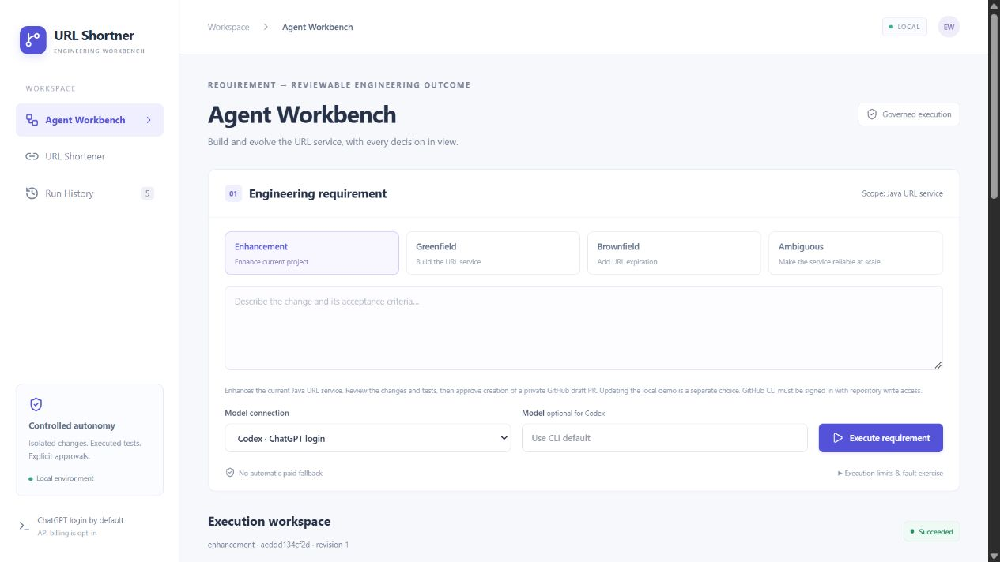

# Enhancement workflow verification — 2026-10-15

The current-project mode and GitHub delivery were verified separately from the
original assignment demonstrations. The prior four exports are preserved
byte-for-byte; the manifest now also includes this fifth real run.

| Check | Result |
|---|---|
| Python control-plane/security tests | 68 passed, 1 Windows symlink-permission skip |
| Frontend typecheck and production build | Passed in the pinned Node 24 Docker toolchain |
| Java regression tests | 100 passed in the isolated runner |
| Independent HTTP executions | 39 passed: 18 against an empty database, 21 against populated V1 |
| Live run | `aeddd134cf2d44d59db0fa37436686f6`, succeeded, 7 ChatGPT-authenticated Codex calls |
| Generated changes | Only `backend/docs/http-behavior.md`; no business-code/logging change |
| Real GitHub delivery | [Draft PR #2](https://github.com/dkaushik62/URL-Shortner/pull/2), unique branch and two files: documentation plus evidence |
| Restart at PR approval | Exact pending approval/revision and 7 model calls preserved |
| Repeat real delivery | Reconciled the same PR URL and commit, with no duplicate |
| Local promotion | Explicitly skipped through the UI; original demo/link preserved |
| Mobile layout | Actual viewport/content widths both 390 pixels |
| Archive integrity | Five manifest checksums and event chains verified |

Tests also cover rejected publication, changed validated source, obsolete approvals,
requirement revision, changed remote branch, migration protection, credential-like
content, repository/command injection and lost PR responses. Lost-response transport
is simulated in automated tests; successful publication and repeat reconciliation
were executed against the real private GitHub repository. Test doubles are not
included as live run evidence. Optional billed providers were not live-called.

The final Python result is [enhancement-python-junit.xml](enhancement-python-junit.xml).
[enhancement-flow.json](enhancement-flow.json) records the live receipts, with
the full run in [the saved export](live-runs/enhancement-aeddd134cf2d44d59db0fa37436686f6.json).
The run's checkpoint decisions were verification automation through the Workbench;
they do not prove an authenticated human identity. Local Git fingerprints normalize
CRLF/LF text endings for delivery comparison; the exact validation fingerprint and
JAR hash remain recorded.

The host Node 20.10 installation could typecheck but could not execute this Vite
version; the documented pinned Docker Node 24 build passed. The first source
comparison also exposed a CRLF/LF mismatch before model calls. It was corrected
and covered by a regression test before the successful live run. No claim is made
that macOS/Linux, cloud deployment or arbitrary future enhancements were verified.

