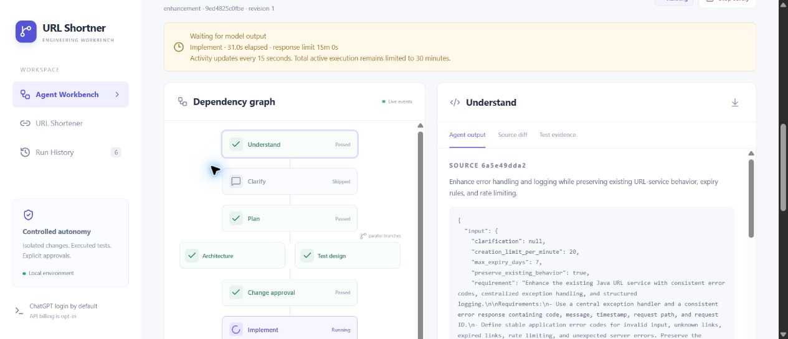

# Model response timeout and recovery

Captured on Windows on 2026-10-15. This is a platform change; the operator's
generated Java enhancement has its own run and approval gates.
That enhancement subsequently succeeded, created merged PR #5 and promoted locally;
its complete sixth run record and final checks are in [FINAL_REPORT.md](FINAL_REPORT.md).

## Observed failure

Run `9ed4825c0fbe47acafdd6a1cb5559c35` completed requirements, planning, parallel
architecture/test design, and interactive change approval. Implementation began
at 00:23:31 IST and stopped at 00:27:31 IST with `Codex call exceeded its timeout`.
The configured deadline was 240 seconds. No implementation artifact, changed
source, validation result or PR existed for that attempt. The run had consumed
five model calls and 368.281 active seconds. Its graph node incorrectly retained
`running` while the run itself was `stopped`.

## Resulting controls

- Default model response limit: 900 seconds; allowed range: 30–1800 seconds.
- The remaining active-run budget still limits the call. Consumed time/calls are
  retained across retries, and there is no automatic provider/billing fallback.
- At most two explicit retries of a Codex timeout from the saved checkpoint.
- Runtime configuration changes are recorded at the checkpoint. Completed
  planning, prior change approval and operation receipts remain available.
- Every 15 seconds, a persisted worker activity event updates elapsed time. This
  is not model token streaming, percent complete, or an ETA.
- Terminal runs show stopped nodes, including old saved snapshots; their original
  audit events are not rewritten.
- Cancel/timeout terminates only the owned Codex launcher and process tree.

## Verification

| Check | Observed result |
|---|---|
| Python suite | 75 passed, 1 skipped. See `timeout-python-junit.xml`. The Windows symlink fixture remains skipped without symlink privileges. |
| Timeout recovery tests | Seven checks passed: defaults/bounds, preserved planning and budgets, stopped nodes, legacy presentation, retry exhaustion, persisted activity, and CLI/process-tree cancellation. Workflow tests use named doubles; the process-tree fixture uses real trusted Python processes. |
| Frontend | TypeScript check and Docker production build passed. |
| Existing Java service | 100 JUnit tests passed in the isolated Docker runner. |
| Protected HTTP checks | 31 passed: 13 URL/rate checks plus 18 expiry/populated V1 upgrade checks. See `timeout-service.json`. These validate the existing service, not the unfinished logging enhancement. |
| Chrome retry | The existing run was retried with 900 seconds, retaining revision 1 and prior change approval. Call count became six; consumed time continued increasing from 368.281 seconds. |
| Chrome live activity | Implementation displayed elapsed time, a 15-minute response limit, and the separate 30-minute active-run cap. See screenshot below. |
| Provider scope | The resumed call uses Codex/ChatGPT authentication. No OpenAI or Claude API call was executed. |

The retry observation does not establish that the logging enhancement passed
Java validation or was delivered to GitHub. Its actual results and approval
decisions remain in the separate live run. Linux/macOS process-group cleanup
is implemented but was not executed on those operating systems in this check.
